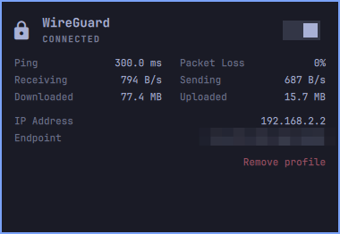
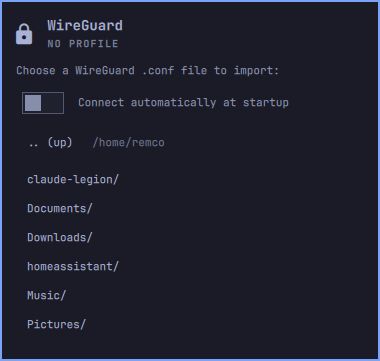

# WireGuard

A WireGuard VPN status icon for the Omarchy bar. Click it to open a details
panel with connection state, ping/packet-loss, live throughput, IP address
and endpoint — the same kind of at-a-glance info as the built-in network
panel, just for a WireGuard tunnel instead of Wi-Fi/Ethernet.

Every WireGuard profile NetworkManager knows about is listed in the panel
with its own connect switch, so you can keep several (home, office, a VPN
provider's locations...) and pick one from the bar. Profiles can be renamed
and removed from the panel, and new ones added from a `.conf` file with an
in-panel file browser.

## Screenshots

<p>
  
  
</p>

## Features

- **Status icon** that lights up while any WireGuard profile is connected
  (the tooltip names which), polled every 5s regardless of whether the
  panel is open.
- **Multiple profiles**: every WireGuard connection in NetworkManager is
  listed, each with its own connect/disconnect switch. Profiles you
  already imported with `nmcli` show up too.
- **Rename** any profile to whatever you like (spaces and accents are
  fine). Only the display name changes, so renaming a connected profile
  doesn't drop it.
- **Details panel**: ping/packet-loss (rolling 10-sample window), live
  download/upload throughput, total bytes transferred, tunnel IP, and peer
  endpoint.
- **One-click connect/disconnect** switches that react as soon as
  NetworkManager has actually applied the change — no polling delay.
- **In-panel `.conf` import** with a plain directory browser (no external
  file-dialog tool required): pick a file, give the profile a name, done.
  Any file name works — the profile gets the next free `wgN` interface.
- **Autoconnect is an explicit opt-in**, off by default. Importing a
  profile never silently sets it up to connect on every boot unless you
  turn on "Connect automatically at startup" for that import.
- **Remove** any profile, with a confirmation prompt, without touching a
  terminal.

## Dependencies

All of these ship with Omarchy itself, so there is nothing extra to
install:

- `nmcli` (`networkmanager`) — lists/toggles/imports/renames the profiles.
  Listed in `omarchy-base.packages`, so every Omarchy install has it.
- `jq` — JSON glue between the shell scripts and the QML widget. Also
  listed in `omarchy-base.packages`.
- `ip` (`iproute2`) — interface state and IP address. A hard dependency of
  `networkmanager` itself.
- `ping` (`iputils`) — latency/packet-loss through the tunnel. Part of
  Arch's `base` package group.

No `wireguard-tools` (`wg`/`wg-quick`) and no file-dialog tool
(`zenity`/`kdialog`/etc.) are used — NetworkManager talks to the kernel
WireGuard module directly, and the "no profile yet" import browser is a
plain script + `Process`, not a native dialog.

The helper scripts in `scripts/` ship inside this repo and are invoked by
path relative to the plugin's own install directory
(`~/.config/omarchy/plugins/remco.wireguard/scripts/...`) — nothing is
expected to already exist elsewhere on your system. Every script output
that reaches the panel is size-capped (directory listings, nmcli error
text, endpoint) and every dynamic string rendered in the UI is displayed
as plain text, never interpreted as rich text/HTML.

## Privilege boundary

Every command runs as your own user through NetworkManager's D-Bus API
(`nmcli`) — no `sudo`. Whether creating or importing a connection profile
needs a polkit prompt depends on your system's polkit rules; on a default
Omarchy install the active local user can usually do this without one.

## Setup

Nothing to configure up front. With no WireGuard profiles yet, the panel
opens straight to the file browser; otherwise use "+ Add profile". Pick a
WireGuard `.conf`, then name the profile. Before importing you can turn on
"Connect automatically at startup" if you want this particular profile to
come up on every boot; leave it off (the default) to keep the tunnel fully
manual.

## Install

```sh
omarchy plugin add https://github.com/r3mcos3/remco.wireguard.git --enable
```

## Usage

Click the icon to open the panel. Use a profile's switch to connect or
disconnect it, "Rename" to change its name (Enter saves, Escape cancels),
and "Remove" to delete it (asks for confirmation first) — this deletes the
NetworkManager connection only, not the original `.conf` file.

Connection details describe the connected profile. If more than one is
connected at once, click a profile's name to choose which one they show.

## Configure

```sh
omarchy bar move remco.wireguard --section right
```

## Uninstall

```sh
omarchy plugin remove remco.wireguard
```

Uninstalling the plugin does not touch your WireGuard NetworkManager
connections — your VPN profiles stay intact. Use "Remove" in the panel
(see [Usage](#usage)) if you want a connection gone too.
